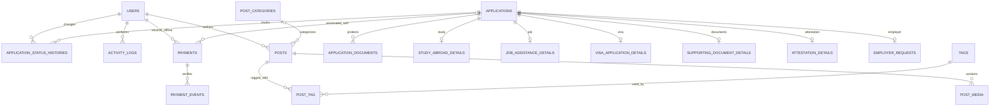

# Edu World application architecture

This document describes the implemented Laravel application. It complements [deployment operations](DEPLOYMENT.md) and the [payment integration guide](PAYMENTS.md). Production credentials, a live payment provider and approval of the business's legal terms are deployment inputs, not bundled defaults.

## Runtime and module boundaries

The application uses Laravel 13, Blade, Eloquent, Form Requests, session authentication, authorization gates, queued notifications and Vite. The current dependency lock requires PHP 8.4 or newer: some locked Symfony 8 packages require 8.4 even if a broader Composer constraint appears in the root manifest. Run Composer's platform check on the actual deployment runtime. MySQL/MariaDB is the production database; automated tests use isolated SQLite databases.

| Location | Responsibility |
| --- | --- |
| `app/Models` | Domain records, relationships, casts and publication scope |
| `app/Http/Controllers` | Public application/contact submission and admin orchestration |
| `app/Http/Controllers/Public` | Marketing pages, published news, legal pages, payments and SEO responses |
| `app/Http/Controllers/Admin` | Dashboard, applications, enquiries, payments, editorial content, settings and users |
| `app/Http/Requests` | Validated public input and authorization for protected mutations |
| `app/Services/Applications` | Transactional submission, annual reference allocation and status updates |
| `app/Services/Payments` | Hosted-checkout interface, disabled default adapter, settlement verification and BHD arithmetic |
| `app/Services/PostManager.php` | Editorial persistence, tag synchronization, media cleanup and publication audits |
| `app/Services/ContentMedia.php` | Image re-encoding, video storage and YouTube URL validation |
| `app/Services/Audit.php` | User/subject/action records with before and after data |
| `app/Notifications` | Applicant acknowledgement, administrator alerts and verified payment confirmation |
| `app/Http/Middleware` | Active-account enforcement, security headers and optional Turnstile verification |
| `app/Providers/AppServiceProvider.php` | Role gates, password rules and rate limits |
| `app/Console/Commands/CreateAdmin.php` | Interactive `edu:admin` bootstrap command |
| `config/applications.php` | Service labels, conditional field definitions, upload categories and status labels |
| `config/service-content.php` | Detailed public service descriptions and CTAs |
| `config/website.php` | Editable website setting keys, defaults and validation rules |
| `config/payments.php` | Provider registration, credentials and checkout-host allowlist |
| `routes/web.php`, `applications.php`, `content.php`, `payments.php` | Named routes grouped by domain |
| `database/migrations`, `factories`, `seeders` | Schema, isolated test data and initial settings/content |
| `resources/views`, `resources/css`, `resources/js`, `public/js` | Blade pages, brand styling and lightweight browser interactions |
| `tests/Feature` | Submission, authorization, documents, publishing, payment and admin regression tests |

## Entity relationships

Diagram source: `docs/ARCHITECTURE.md`.

`application_sequences`, `enquiries`, `settings` and `pages` stand independently. Audit subjects are polymorphic and may refer to applications, documents, payments, posts, pages, settings or users. The diagram shows the user side of that relationship; it does not imply a foreign key from audit subjects to every domain table.

An application has zero or one row in its selected service table. A unique `application_id` in each detail table enforces the individual one-to-one relationship. The submission service chooses exactly the configured relationship; an `other` application stores its message in `applications.remarks`. The schema does not attempt to enforce cross-table service exclusivity with a database trigger.

## Tables and important fields

All domain tables use normal Laravel timestamps unless noted. Foreign keys and unique indexes are defined in migrations.

| Table | Important fields and constraints |
| --- | --- |
| `users` | Name, unique email, hashed password, `role`, `is_active`; optional email verification and remember token |
| `applications` | Unique `reference_number`; service; applicant name, nationality, birth date, country/city, phone/email, contact preference; application/payment status; internal notes; other-service remarks; both consents, consent timestamp and version |
| `application_sequences` | Year primary key, last allocated number; no timestamps; locked during allocation |
| `application_documents` | Application FK, document category, disk, randomized relative path, original display name, detected MIME type and bytes |
| `application_status_histories` | Application FK, nullable staff user FK, previous/new status, note and timestamps |
| `study_abroad_details` | Unique application FK; qualification/year/institution, course/study level/countries, budget/intake and English test |
| `job_assistance_details` | Unique application FK; occupation/category, experience/employer, GCC residency, driving license/category, preferred country and languages |
| `visa_application_details` | Unique application FK; destination/type/purpose, travel date/duration, residency and previous visa history |
| `supporting_document_details` | Unique application FK; requested services JSON list, destination, start/end dates, traveler count and remarks |
| `attestation_details` | Unique application FK; document type, issuing/destination country, purpose and document count |
| `employer_requests` | Unique application FK; company/country/industry, roles, headcount, work location, start date and requirements |
| `enquiries` | Name/contact/service/message, `new`/`contacted`/`resolved` status, internal notes and contacted/resolved timestamps |
| `payments` | Nullable application FK; unique transaction reference; payer-supplied reference; gateway/session reference; gateway/offline channel; payer/contact/service; `DECIMAL(12,3)` amount and received amount; BHD currency; status; remarks; minimal gateway metadata; settlement/refund timestamps; offline recorder/reference |
| `payment_events` | Payment FK; gateway/event ID unique pair; payload fingerprint; verified status and applied/stale result |
| `post_categories` | Name and unique slug |
| `posts` | Nullable category/author FKs; title and unique slug; excerpt/body/author display name; featured image/alt text; validated YouTube ID; CTA label/URL; SEO title/description; publish/feature flags and publication time |
| `post_media` | Post FK; relative file path, image/video type, MIME, original name, alt text, size and ordering |
| `tags` | Name and unique slug |
| `post_tag` | Post/tag FKs with composite primary key |
| `pages` | Title, unique fixed legal-page slug, text body, SEO title/description and `review_required` flag |
| `settings` | Unique key, nullable text value; reads cached and cache invalidated after changes |
| `activity_logs` | Nullable user FK, action, polymorphic subject type/ID, before/after JSON and timestamps |

Framework tables are `password_reset_tokens`, `sessions`, `cache`, `cache_locks`, `jobs`, `job_batches`, `failed_jobs`, plus Laravel's `migrations` bookkeeping table. The password-token table is framework infrastructure; this application does not expose public registration or a password-reset UI.

Application indexes cover reference, service, nationality, current country, phone, email, status, payment status and creation time. Payment indexes include transaction reference, gateway/reference pair, channel, contact fields, service, status and relevant dates. Posts index publication visibility/time and featured status. Enquiries index email, service, status and creation time.

Deleting an application at the database level cascades its details/documents/history and nulls linked payment application IDs; deleting a post cascades media rows and tag links. Physical files require the relevant service cleanup and are not deleted automatically by SQL cascades. The admin UI intentionally provides no application deletion endpoint. User removal nulls historical staff/author relationships where configured.

## Eloquent relationship names

| Model | Relationships |
| --- | --- |
| `Application` | `documents`, `statusHistory`, `payments`, `studyDetails`, `jobDetails`, `visaDetails`, `supportingDocumentDetails`, `attestationDetails`, `employerRequest` |
| Application detail/document models | `application` |
| `ApplicationStatusHistory` | `application`, `user` |
| `Payment` | `application`, `recordedBy`, `events` |
| `PaymentEvent` | `payment` |
| `Post` | `category`, `author`, `media`, `tags` |
| `PostCategory`, `Tag` | `posts` |
| `PostMedia` | `post` |

## Routes

Use `php artisan route:list --except-vendor` as the executable route inventory. Core routes are:

| Method | Path | Name / access |
| --- | --- | --- |
| GET | `/` | `home`, public |
| GET | `/services` | `services`, public |
| GET / POST | `/apply` | `apply` / `apply.store`; POST throttled and optionally CAPTCHA checked |
| GET | `/apply/received` | `apply.success`; requires the submitting browser session |
| GET / POST | `/contact` | `contact` / `contact.store`; POST throttled and optionally CAPTCHA checked |
| GET | `/news` | `news`; category/tag filters and pagination |
| GET | `/news/{slug}` | `news.show`; published posts only |
| GET | `/news/images/{post}`, `/news/media/{media}` | `news.image` / `news.media`; published content or authorized content staff |
| GET | `/privacy-policy`, `/terms`, `/payment-terms`, `/refund-policy`, `/disclaimer` | Fixed legal-page route names match slugs |
| GET / POST | `/pay` | `pay` / `pay.store`; POST throttled and optionally CAPTCHA checked |
| GET | `/pay/receipt/{payment}` | `pay.receipt`; expiring signed URL |
| POST | `/payments/webhook/{gateway}` | `pay.webhook`; rate-limited; provider verification required; CSRF exemption limited to this integration route |
| GET | `/sitemap.xml`, `/robots.txt`, `/up` | Sitemap, crawler rules, Laravel health response |
| GET / POST | `/admin/login` | `login` / `login.store`; guest only, login throttled |
| POST | `/admin/logout` | `logout`; authenticated |
| GET | `/admin`, `/admin/dashboard` | Dashboard redirect / `admin.dashboard`; active staff |
| GET | `/admin/applications`, `/admin/applications/{application}` | `admin.applications.index` / `.show`; application gate |
| PATCH | `/admin/applications/{application}` | `admin.applications.update`; application gate |
| GET | `/admin/documents/{document}/download` | `admin.documents.download`; application gate and access audit |
| GET / PATCH | `/admin/enquiries`, `/admin/enquiries/{enquiry}` | Index/show/update; enquiry gate |
| GET | `/admin/payments`, `/admin/payments/{payment}` | Payment index/show; payment gate |
| PATCH | `/admin/payments/{payment}/application` | `admin.payments.link`; payment gate |
| GET / POST | `/admin/payments/offline/create`, `/admin/payments/offline` | Offline receipt form/store; super admin |
| POST | `/admin/payments/{payment}/offline-refund` | Offline refund record; super admin |
| Resource | `/admin/posts` | Index/create/store/edit/update/destroy; content gate; separate post-media delete route |
| Resource | `/admin/categories` | Index/store/update/destroy; content gate |
| Resource | `/admin/pages` | Index/edit/update; content gate |
| GET / PUT | `/admin/settings` | Settings edit/update; super admin |
| Resource | `/admin/users` | Index/create/store/edit/update; super admin; deactivate instead of deleting |
| GET | `/admin/audit` | Activity log; super admin |

## Authentication and authorization

Session login verifies email/password and active status, regenerates the session ID and records a login audit. Logout invalidates the session and rotates the CSRF token. Active-user middleware rejects disabled users even if they still possess a session. Password rules require at least 12 characters with mixed case, numbers and symbols. Public registration is absent.

| Capability | Super admin | Admin | Content manager |
| --- | --- | --- | --- |
| Admin dashboard | Yes | Yes | Yes |
| Applications, protected documents and enquiries | Yes | Yes | No |
| Payment review and application association | Yes | Yes | No |
| Offline receipt / offline refund records | Yes | No | No |
| Posts, gallery, categories and legal-page content | Yes | No | Yes |
| Website settings, staff accounts and audit viewer | Yes | No | No |

These rules are server-side gates: `access-admin`, `manage-applications`, `manage-enquiries`, `manage-payments`, `view-reports`, `manage-content`, `manage-settings` and `manage-users`. Hiding menu links supplements rather than replaces route authorization. Application/payment mutations additionally validate input and enforce the service boundary.

## Application submission and review

1. `/apply` renders the service configuration. Browser JavaScript switches relevant fieldsets without a page reload and disables irrelevant inputs. All security decisions are repeated on the server.
2. `StoreApplicationRequest` validates applicant/contact data, the selected service's allowed detail keys, required service fields and both consent checkboxes. Birth date, choice lists, numeric ranges and date ordering receive server-side checks. A honeypot, request throttle and optional Turnstile protect the public endpoint.
3. Documents are limited to PDF/JPEG/PNG, 10 MB each, five per category and twelve total. The extension must match the detected MIME type. Upload errors, executables, unexpected categories and mismatched extensions are rejected.
4. `SubmitApplication` starts a transaction. `ReferenceGenerator` creates or locks the current-year sequence row and allocates the next number. The format is `EW-2026-00001`; a unique database index is the final collision constraint. Allocation and application insertion succeed or roll back together. Numbers may grow beyond five digits and must never be truncated. The service retries database deadlocks and cleans up files from failed attempts.
5. The common application, selected service detail record, document metadata, initial `new` history event and consent timestamp/version are saved. File names are randomized. On persistence failure, newly stored files are removed before the exception propagates.
6. After persistence, queued notifications acknowledge the applicant and notify the administrator. The administrator address comes from the `application_notification_email` setting, falling back to `ADMIN_EMAIL`. A mail transport failure does not reverse the saved submission. Operators must monitor the queue and application logs.
7. The submitting session receives a confirmation reference. There is no public endpoint that reveals a person's application by guessing a sequential reference.
8. Authorized staff filter by keyword/reference, service, nationality, country, status, payment status and date range, then review details and download private documents. Each successful download is audited.
9. Staff update status/internal notes through a transaction with a locked application row. History records previous/new status, staff member, time and optional note. The normal business progression is New → Under Review → Documents Required → Processing → Completed → Closed; authorized staff may choose any configured status as the case requires.

Consent records prove what was recorded by the form; the application does not implement automated retention or privacy-request processing. Those operational procedures must be established by the business.

## File access and content publication

`private` and `local` disks point to `storage/app/private` with automatic serving disabled. Application files are in `applications/{id}`; editorial images/videos are in `cms`. Application downloads require staff authentication and the application gate. CMS files are served through controllers that check their post's publication state; drafts and future-dated posts/media return 404 to public visitors. Editorial images are resized and re-encoded; identity documents are preserved.

The separate `public` disk points to `storage/app/public` and is used for deliberately public branding assets. `public/storage` may link only to this public directory. Never link `storage/app/private`, `storage`, or the project root into the document root.

Posts appear publicly only when `is_published` is true, a publication timestamp exists and that timestamp is not in the future. The same scope drives listing/detail pages, the homepage and sitemap. Scheduled visibility is evaluated per request and does not require a publication scheduler. Bodies are rendered as escaped text; CTA and YouTube URLs are validated. Legal pages have an administrative review flag; that flag does not hide them from the public website.

## Payments and operational boundaries

The default `DisabledGateway` records pending payment requests and clearly reports unavailable checkout. It does not simulate a payment. A real hosted-checkout adapter must implement `PaymentGatewayInterface`, be registered and allowlisted, and be verified in the provider's sandbox before activation. Environment credentials alone cannot enable the feature. See [PAYMENTS.md](PAYMENTS.md) for the adapter contract and event requirements.

Payments use decimal BHD values with three places and integer fils for comparisons. Publicly entered references never automatically associate a payment with an application. Staff explicitly verify and link them. Only authenticated, verified provider callbacks may settle gateway transactions; browser redirects cannot update money status. Unique provider event IDs, fingerprints, row locking and stale-event handling provide idempotency. Full offline receipts/refunds are separately labeled super-admin records and do not transfer money. Application payment status is derived from linked records; it is not an invoice balance or accounting ledger.

## Implementation phases and verification

The project is organized for the requested delivery phases: schema/authentication, public site, applications/documents, editorial CMS, payment architecture, administration/settings/audits, SEO/security, and tests/deployment. Migrations install in dependency order; seeders populate website settings, editorial categories, general guidance articles and legal drafts. They create no production administrator password.

Feature coverage exercises service-specific submissions, annual references and rollback, consent validation, private upload permissions, status history, contact management, authentication/roles, draft and scheduled publication, editorial media, payment verification/idempotency and offline permissions. Use the current test output rather than a permanently copied test count. Production deployment additionally needs real database, mail, HTTPS, filesystem and selected-provider acceptance checks; SQLite feature tests do not replace those environment checks.
